# Pulse

**Pulse** is a Flutter crypto market tracker that pairs CoinGecko metadata with Binance live prices. It is built as a portfolio reference: feature-first modules, cache-first REST, a single shared WebSocket pipeline, strict analysis, and tests at every layer—without trading or accounts.

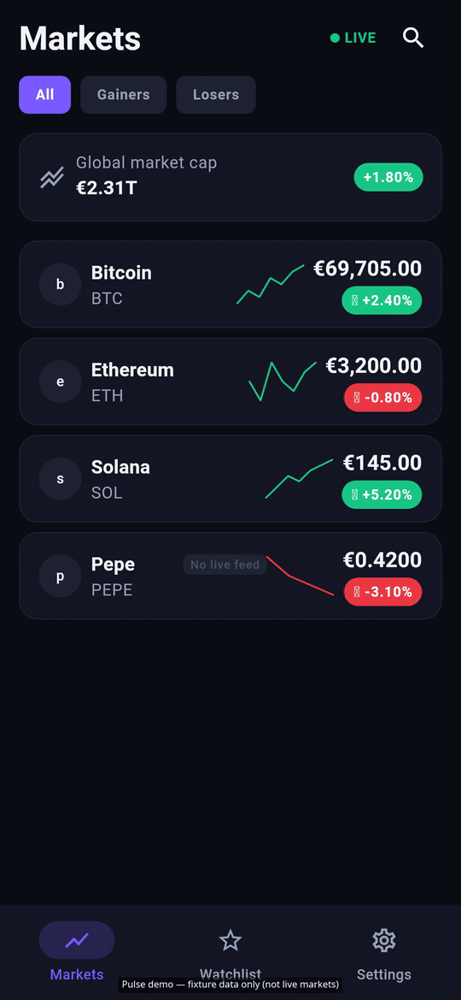

> Demo frames use **fixture data** (see filenames under `docs/screenshots/`). Binance public streams and CoinGecko Demo API power production builds when keys and network are available.

## Features

| Area | What you get |
|------|----------------|
| **Markets** | Top coins with sparklines, search, filters (all / gainers / losers / watchlist), pull-to-refresh, stale-offline banner |
| **Live prices** | Binance `@ticker` over one WebSocket; EUR display via live EUR/USDT; flash + connection indicator |
| **Coin detail** | Chart ranges 1D–1Y (`fl_chart`), stats, about, external links, watchlist star |
| **Watchlist** | Persisted order, swipe remove + undo, live rows |
| **Settings** | Theme, English / Serbian Latin, USD or EUR display currency, cache clear |

## Screenshots

| | | |
|:---:|:---:|:---:|
| 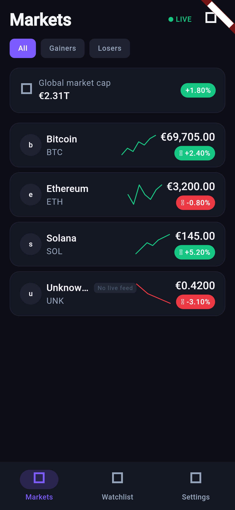 | 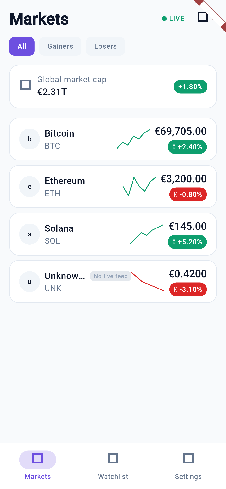 | 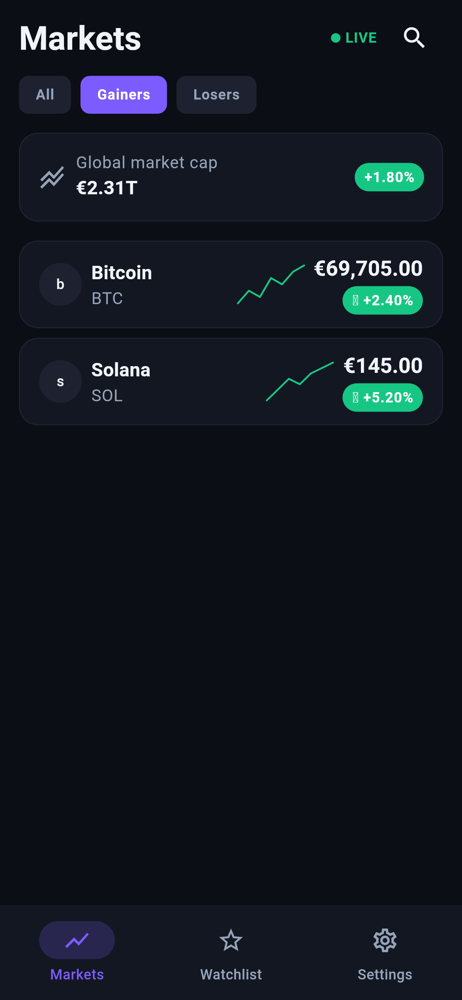 |
| 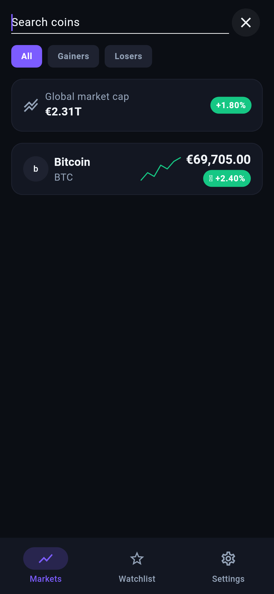 | 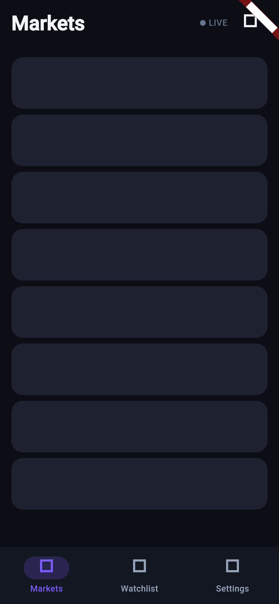 | 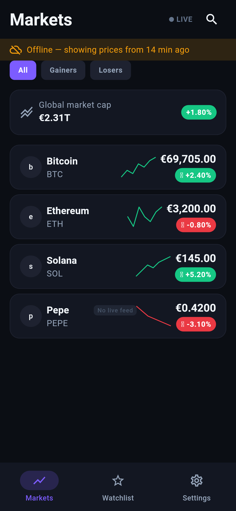 |
| 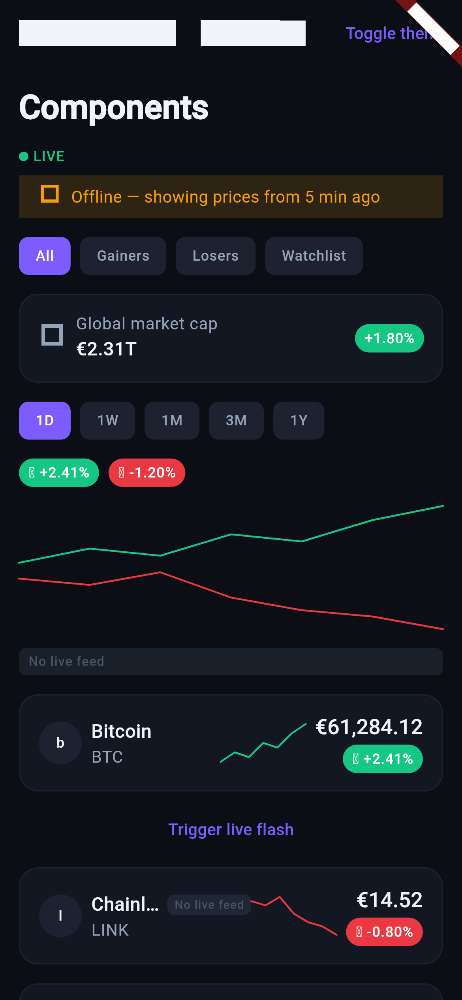 | 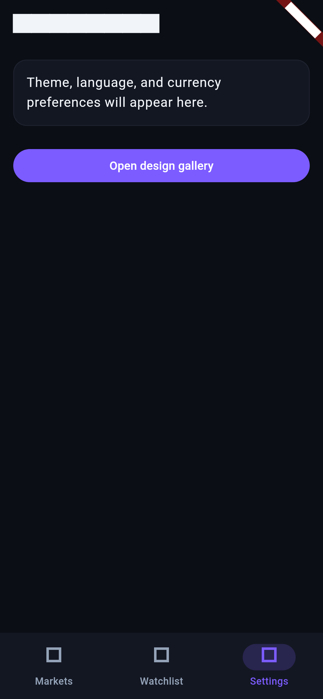 | 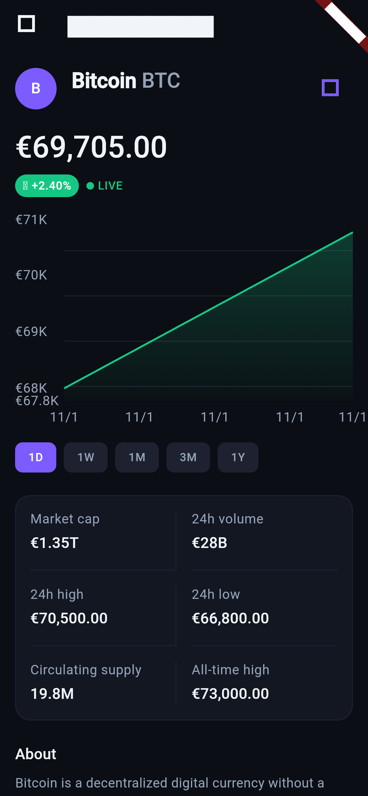 |

More frames: `docs/screenshots/` (Serbian locale, design gallery scroll, etc.).

## Tech stack

- **Flutter** 3.35+ · **Dart** 3.9+
- **State:** `flutter_bloc`, `bloc_concurrency`
- **Navigation:** `go_router` (shell + deep links)
- **DI:** `get_it` (composition root only)
- **Network:** `http`, `web_socket_channel`
- **Storage:** Hive (`CacheStore`, preferences, watchlist)
- **Charts:** `fl_chart`
- **L10n:** ARB (`en`, `sr_Latn`)
- **Tests:** `flutter_test`, `bloc_test`, `mocktail`, `integration_test` (device-only); CI happy path in **`test/pulse_happy_path_test.dart`**

## Architecture (overview)

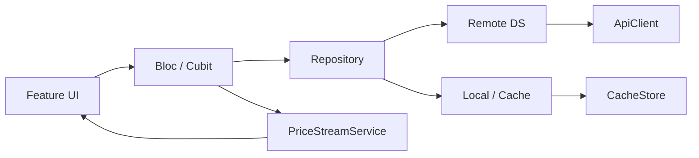

Details, folder layout, and error model: **[docs/architecture.md](docs/architecture.md)** · realtime: **[docs/realtime.md](docs/realtime.md)** · TTLs: **[docs/caching.md](docs/caching.md)** · APIs: **[docs/api.md](docs/api.md)** · delivery: **[docs/roadmap.md](docs/roadmap.md)** · agents: **[AGENTS.md](AGENTS.md)**

## Getting started

Requires [Flutter stable](https://docs.flutter.dev/get-started/install) (CI uses **3.35.7**).

```bash
flutter pub get
flutter gen-l10n   # runs via pub get when ARBs change
flutter run --dart-define=COINGECKO_DEMO_API_KEY=your_demo_key
```

Application ID: **`com.doriansabo.pulse`**

| Variable | Purpose |
|----------|---------|
| `COINGECKO_DEMO_API_KEY` | CoinGecko Demo API key (`--dart-define`); never commit |

Binance read-only market endpoints do not require a key.

## Test & coverage

CI and default local runs use **fakes**—no live Binance or CoinGecko.

| Suite | File | Where it runs |
|-------|------|----------------|
| **Widget happy path** | `test/pulse_happy_path_test.dart` | CI + local (`flutter test`) |
| **Device integration** | `integration_test/app_test.dart` | Local emulator/device only |

The happy path covers **Markets → coin detail → watchlist star → watchlist tab**. CI runs it in **`test/pulse_happy_path_test.dart`** (real **`AppRoutes`** / shell navigation with injected test blocs). **`integration_test/app_test.dart`** runs the same flow on a device with **`PulseApp`** and **`initPulseTestDependencies()`** (stub repos + fakes).

**Line coverage (lib/, from `coverage/lcov.info`):** ~**74.9%** before step 8 → ~**76.3%** after (2952→3008 / 3942 lines hit).

```bash
dart format lib test integration_test tool
flutter analyze
flutter test --coverage
bash tool/check_generated.sh
```

Optional:

```bash
# Same flow on a connected device (not run in CI)
flutter test integration_test/app_test.dart -d <deviceId>

bash tool/screenshots.sh    # fixture PNGs
bash tool/build_demo.sh     # docs/demo/*.gif|mp4
```

Coverage is uploaded from CI as `coverage/lcov.info` with an informational summary; there is no failing threshold.

## Project structure

```text
lib/
  core/          # ApiClient, Result, cache, realtime, theme, router, DI
  markets/       # list + bloc + repository
  coin_detail/   # chart, detail, live merge
  watchlist/     # persistence + UI
  settings/      # theme, locale, currency
  shell/         # bottom navigation
test/            # unit, bloc, widget; pulse_happy_path_test.dart (CI flow)
integration_test/ # app_test.dart — device runs only (see README there)
tool/            # screenshot harness, demo stitch, codegen checks
docs/            # architecture, roadmap, screenshots, demo
```

## Key decisions

| Topic | Choice |
|-------|--------|
| List ranking & copy | CoinGecko |
| Live price & klines | Binance public REST + WebSocket |
| Offline | Cache-first TTL; stale success + banner on refresh failure |
| EUR live display | USDT ticks ÷ live EUR/USDT |
| Missing Binance pair | Row still shown; “no live feed” badge |
| Persistence | Hive (see caching doc) |
| License | MIT |

## Roadmap & limitations

Roadmap **steps 1–8** deliver setup through watchlist/settings, test polish, README, architecture docs, and demo media (step 8 lands via PR #14). **Out of scope:** React Native twin (separate repo), accounts, portfolios, push alerts.

Known limits: Demo API rate limits; WebSocket closes ~30s in background; chart/kline source falls back per [architecture](docs/architecture.md) when no USDT pair exists.

## Data sources

- [Binance Spot API](https://github.com/binance/binance-spot-api-docs) — public market data
- [CoinGecko Demo API](https://docs.coingecko.com/demo/reference/introduction) — metadata and market cap ranks

## CI

GitHub Actions on PRs and `main`: **`dart format`** (`lib`, `test`, `integration_test`, `tool`), **`flutter analyze`**, **`flutter test --coverage`**, generated-code check, debug APK. Coverage artifact + non-blocking `lcov` summary. **No device integration job.** iOS build on push to `main` (macOS, no codesign).

## License

MIT — see [LICENSE](LICENSE). Copyright (c) 2026 Dorian Sabo.
