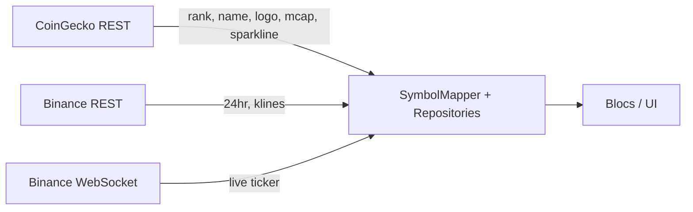

# External APIs

Pulse uses **Binance Spot** public market data (no API key) and the **CoinGecko Demo API** (free key required). Base URLs and limits below were verified against official documentation in October 2025; **CoinGecko Demo 100 calls/min re-checked November 2026** ([Errors & rate limits](https://docs.coingecko.com/docs/errors-and-rate-limits)). Binance **6000 REQUEST_WEIGHT / minute** remains as documented in [REST API](https://github.com/binance/binance-spot-api-docs/blob/master/rest-api.md) via `GET /api/v3/exchangeInfo` → `rateLimits` (not re-fetched in CI; confirm before release).

> **Step 4 note:** When wiring markets REST, re-validate Binance `ticker/24hr` batch **request weights** for your symbol count via live `exchangeInfo` (weights depend on batch size; see table below).

## Binance Spot REST

| Property | Value |
|----------|--------|
| Base URL | `https://api.binance.com` |
| Auth | **None** for market data endpoints listed here |
| Rate limits | IP-based; see `GET /api/v3/exchangeInfo` → `rateLimits` (typical **6000 REQUEST_WEIGHT / minute**) |
| Headers | `X-MBX-USED-WEIGHT-1M` reports current weight |
| Errors | **429** rate limit; **418** IP ban; `Retry-After` header may be present |

Official docs: [REST API](https://github.com/binance/binance-spot-api-docs/blob/master/rest-api.md)

### Endpoints used

#### Exchange info (symbol map bootstrap)

```http
GET /api/v3/exchangeInfo?permissions=SPOT
```

**Weight:** 20 (full exchange) — call rarely; cache locally for days.

Use to resolve tradable `*USDT` pairs and `status == TRADING`.

#### 24h ticker (markets REST snapshot)

```http
GET /api/v3/ticker/24hr?symbols=["BTCUSDT","ETHUSDT"]
```

| Param | Notes |
|-------|--------|
| `symbols` | JSON array, URL-encoded; **max 100** symbols per request |
| Weight | 2 (1–20 symbols), **40** (21–100), 80 (101+ / all) |

**Sample (abbreviated):**

```json
{
  "symbol": "BTCUSDT",
  "lastPrice": "67234.51000000",
  "priceChangePercent": "-1.234",
  "highPrice": "68000.00000000",
  "lowPrice": "66500.00000000",
  "volume": "12345.67890000",
  "quoteVolume": "823456789.12345678",
  "openTime": 1730000000000,
  "closeTime": 1730086399999
}
```

#### Latest price (optional batch)

```http
GET /api/v3/ticker/price?symbols=["BTCUSDT"]
```

Weight: 4 for multi-symbol requests.

#### Klines (charts)

```http
GET /api/v3/klines?symbol=BTCUSDT&interval=1h&limit=500
```

| Param | Notes |
|-------|--------|
| `interval` | `1m`, `5m`, `15m`, `1h`, `4h`, `1d`, `1w`, … |
| `limit` | Default 500; **max 1000** |
| Weight | 2 |

**Sample (array of arrays):**

```json
[
  [
    1499040000000,
    "0.01634790",
    "0.80000000",
    "0.01575800",
    "0.01577000",
    "148976.11427815",
    1499644799999,
    "2434.19055334",
    308,
    "1756.87402397",
    "28.46694368",
    "17928899.62484339"
  ]
]
```

Fields: open time, open, high, low, close, volume, close time, quote volume, trades, taker buy base, taker buy quote, ignore.

### Binance WebSocket (market streams)

| Property | Value |
|----------|--------|
| Base | `wss://stream.binance.com:9443` or `:443` |
| Auth | **None** |
| Stream format | `<symbol lowercase>@ticker` e.g. `btcusdt@ticker` |
| Combined | `wss://stream.binance.com:9443/stream?streams=btcusdt@ticker/ethusdt@ticker` |
| Dynamic | Connect to `/ws` or `/stream`, send `{"method":"SUBSCRIBE","params":["btcusdt@ticker"],"id":1}` |
| Limits | **1024** streams/connection; **5** incoming messages/sec; **300** connections / 5 min / IP |
| Lifetime | **24 hours** then disconnect |
| Keepalive | Server ping **20s**; client must pong |

**Sample `@ticker` payload (abbreviated):**

```json
{
  "e": "24hrTicker",
  "E": 1672515782136,
  "s": "BTCUSDT",
  "c": "67234.51000000",
  "P": "-1.234",
  "h": "68000.00000000",
  "l": "66500.00000000"
}
```

Alternative market-only endpoint (no user streams): `wss://data-stream.binance.vision` — same stream names.

Official docs: [WebSocket streams](https://github.com/binance/binance-spot-api-docs/blob/master/web-socket-streams.md)

---

## CoinGecko Demo API

| Property | Value |
|----------|--------|
| Base URL | `https://api.coingecko.com/api/v3/` |
| Auth | **Required** — Demo API key |
| Header (recommended) | `x-cg-demo-api-key: <KEY>` |
| Query (dev only) | `x_cg_demo_api_key=<KEY>` |
| Rate limit | **100 requests / minute** (Demo plan) |
| Monthly credits | **10,000** successful (HTTP 200) calls/month (per CoinGecko marketing/docs; confirm in [Developer Dashboard](https://docs.coingecko.com/docs/setting-up-your-api-key)) |
| Errors | **401** missing/invalid key; **429** rate limit; code **10002** if key missing |

Official docs: [Demo authentication](https://docs.coingecko.com/demo/reference/authentication), [Errors & rate limits](https://docs.coingecko.com/docs/errors-and-rate-limits)

> **Uncertainty:** Exact monthly credit counter behaviour for failed requests (4xx) — CoinGecko states all requests count toward per-minute rate limit including errors; monthly credit deduction for non-200 responses should be confirmed in dashboard docs before relying on it in telemetry.

### Endpoints used

#### Coins list (ID map)

```http
GET /coins/list
```

Returns `[{ "id", "symbol", "name" }, ...]`. Cache long-lived locally.

#### Global market data (markets summary card)

```http
GET /global
Header: x-cg-demo-api-key: ***
```

Returns `data.total_market_cap` (map including `eur`) and `data.market_cap_change_percentage_24h_usd` for the summary change pill. Official: [Crypto Global](https://docs.coingecko.com/reference/crypto-global).

#### Markets (top coins + sparkline)

```http
GET /coins/markets?vs_currency=eur&order=market_cap_desc&per_page=100&page=1&sparkline=true&price_change_percentage=24h
Header: x-cg-demo-api-key: ***
```

| Param | Notes |
|-------|--------|
| `per_page` | 1–**250** |
| `sparkline` | 7-day mini chart array when `true` |
| `vs_currency` | `usd`, `eur`, … |

**Sample (abbreviated):**

```json
[
  {
    "id": "bitcoin",
    "symbol": "btc",
    "name": "Bitcoin",
    "current_price": 67234.5,
    "market_cap": 1320000000000,
    "market_cap_rank": 1,
    "total_volume": 25000000000,
    "high_24h": 68000,
    "low_24h": 66500,
    "price_change_percentage_24h": -1.23,
    "image": "https://assets.coingecko.com/coins/images/1/large/bitcoin.png",
    "sparkline_in_7d": { "price": [65000, 65500, 66000] }
  }
]
```

#### Coin detail (metadata + description)

```http
GET /coins/bitcoin?localization=false&tickers=false&market_data=true&community_data=false&developer_data=false
Header: x-cg-demo-api-key: ***
```

Use `description.en` (and future SR strategy), `links.homepage`, `image`, `market_data`.

#### Market chart (fallback charts)

```http
GET /coins/bitcoin/market_chart?vs_currency=usd&days=7
Header: x-cg-demo-api-key: ***
```

| `days` | Auto granularity (if `interval` omitted) |
|--------|------------------------------------------|
| 1 | ~5 minutes |
| 2–90 | hourly |
| >90 | daily |

**Demo plan:** historical data restricted to **past 365 days** (official warning on endpoint doc).

**Sample (abbreviated):**

```json
{
  "prices": [[1779027899041, 77953.82]],
  "market_caps": [[1779027899041, 1560631481361.8]],
  "total_volumes": [[1779027899041, 18688431751.85]]
}
```

#### Search (optional)

```http
GET /search?query=btc
```

For markets search UI; debounce client-side.

---

## Data fusion in Pulse



1. **Markets screen:** CoinGecko `/coins/markets` defines ordering and metadata; Binance symbols attached via mapper; live updates from WS; REST 24hr for initial/sync.
2. **Detail:** CoinGecko `/coins/{id}` + Binance klines for chart; WS for live price.
3. **Display currency EUR:** CoinGecko supports `vs_currency=eur`; Binance pairs remain USDT — convert for display or prefer CG `current_price` for static fields and USDT live from Binance (document in UI).

---

## Environment configuration

| Key | Where |
|-----|--------|
| `COINGECKO_DEMO_API_KEY` | `--dart-define=COINGECKO_DEMO_API_KEY=...` in run/build; CI secret for integration tests only |

Never commit keys. Binance public endpoints need no secret.

---

## Compliance

- Respect rate limits; exponential backoff on 429.
- CoinGecko [terms](https://www.coingecko.com/en/api_terms) and attribution if required when shipping publicly.
- Binance data is unauthenticated market data; no order placement in Pulse v1.
