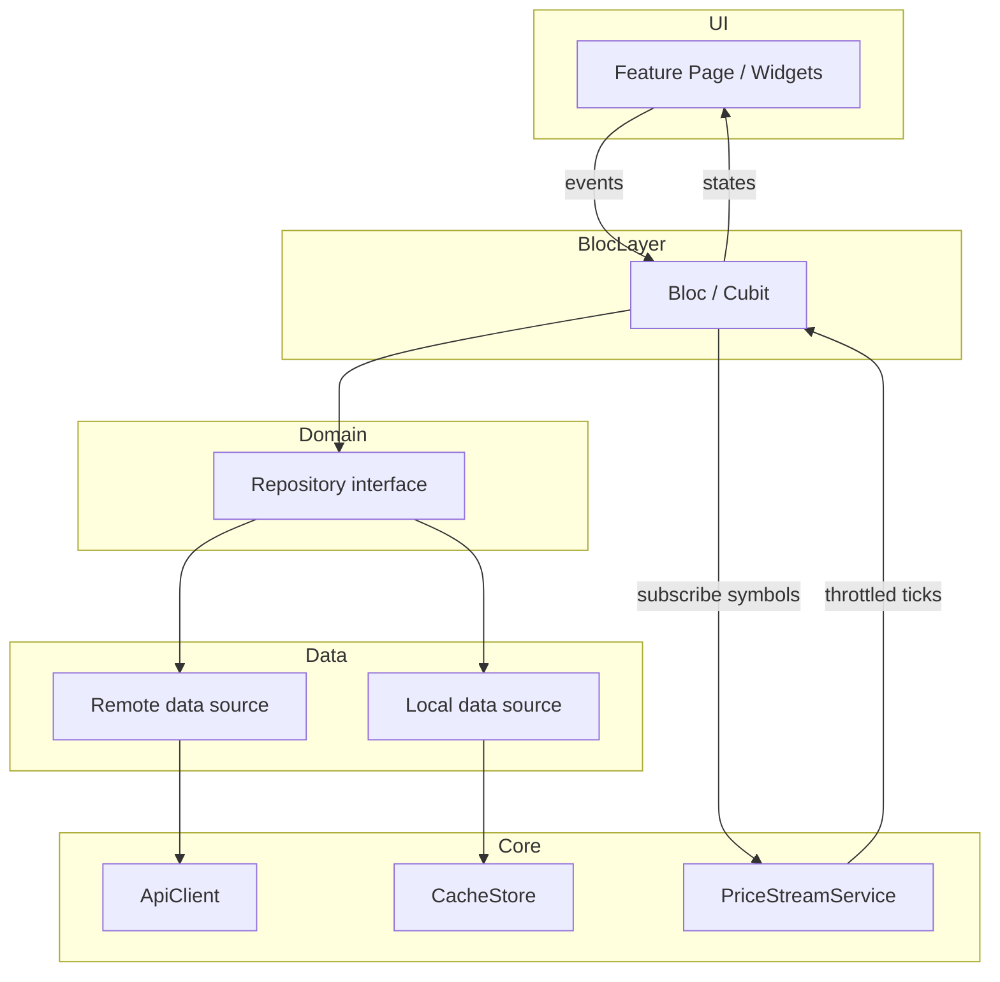

# Architecture

Pulse uses **feature-first** modules with a thin **shell** and a shared **core**. UI never calls HTTP or WebSocket APIs directly; data flows in one direction.

## Principles

1. **Feature-first folders** — each feature owns models, repository (interface + impl + data sources), bloc/cubit, and UI.
2. **Constructor injection** — dependencies are passed into constructors; `get_it` registers types only in `core/di/`.
3. **Repository interfaces** — Blocs depend on abstractions; implementations compose remote and local data sources.
4. **Sealed results** — domain and repository layers return `Result<T>` with `AppFailure` instead of throwing for expected errors.
5. **Strict analysis** — `analysis_options.yaml` treats warnings as errors where practical; no ignored lints without a comment.

## Folder tree

```text
lib/
├── main.dart                          # bootstrap, runApp
├── app.dart                           # MaterialApp.router, theme, l10n
├── core/
│   ├── config/
│   │   ├── app_config.dart            # env, base URLs, feature flags
│   │   └── api_keys.dart              # dart-define readers (CoinGecko)
│   ├── di/
│   │   └── injection.dart             # get_it registration (ONLY place)
│   ├── error/
│   │   ├── app_failure.dart           # sealed failure types
│   │   └── result.dart                # sealed Result<T>
│   ├── network/
│   │   ├── api_client.dart            # http wrapper, timeouts, decode
│   │   └── network_exception.dart
│   ├── realtime/
│   │   ├── price_stream_service.dart  # shared Binance WS (see realtime.md)
│   │   ├── price_tick.dart
│   │   └── symbol_mapper.dart         # CoinGecko id ↔ Binance symbol
│   ├── storage/
│   │   ├── cache_store.dart           # TTL read/write, corrupt entry drop
│   │   ├── preferences_store.dart     # settings, watchlist order
│   │   └── hive_boxes.dart            # box names, adapters registration
│   ├── router/
│   │   └── app_router.dart            # go_router routes + shell
│   ├── theme/
│   │   ├── app_theme.dart
│   │   └── app_colors.dart            # semantic tokens only
│   └── widgets/
│       ├── async_state_view.dart      # loading / error / empty
│       ├── price_text.dart
│       └── stale_badge.dart           # "Updated X min ago"
├── shell/
│   └── ui/
│       └── main_shell.dart            # bottom nav / navigation rail
├── markets/
│   ├── models/
│   │   ├── market_coin.dart
│   │   └── markets_sort.dart
│   ├── repository/
│   │   ├── markets_repository.dart    # abstract
│   │   ├── markets_repository_impl.dart
│   │   └── data_sources/
│   │       ├── markets_remote_data_source.dart   # CoinGecko + Binance REST
│   │       └── markets_local_data_source.dart    # list cache
│   ├── bloc/
│   │   ├── markets_bloc.dart
│   │   ├── markets_event.dart
│   │   └── markets_state.dart
│   └── ui/
│       ├── markets_page.dart
│       └── widgets/
│           └── market_list_tile.dart
├── coin_detail/
│   ├── models/
│   │   ├── coin_detail.dart
│   │   ├── chart_range.dart
│   │   └── candle.dart
│   ├── repository/
│   │   ├── coin_detail_repository.dart
│   │   ├── coin_detail_repository_impl.dart
│   │   └── data_sources/
│   │       ├── coin_detail_remote_data_source.dart
│   │       └── chart_local_data_source.dart
│   ├── bloc/
│   │   ├── coin_detail_bloc.dart
│   │   └── ...
│   └── ui/
│       ├── coin_detail_page.dart
│       └── widgets/
│           └── price_chart.dart
├── watchlist/
│   ├── models/
│   │   └── watchlist_entry.dart
│   ├── repository/
│   │   ├── watchlist_repository.dart
│   │   └── watchlist_repository_impl.dart
│   ├── bloc/
│   │   └── watchlist_cubit.dart
│   └── ui/
│       └── watchlist_page.dart
└── settings/
    ├── models/
    │   └── user_preferences.dart
    ├── repository/
    │   └── settings_repository.dart
    ├── bloc/
    │   └── settings_cubit.dart
    └── ui/
        └── settings_page.dart

test/
├── core/
│   └── realtime/
│       └── fake_price_stream_service.dart
├── markets/
│   └── ...
└── ...
```

## Data flow



**Live prices:** REST (or cache) loads the initial list; Blocs register interest with `PriceStreamService`; ticks merge into existing `Equatable` state (price, 24h change where available from ticker stream).

## Key decisions

| Decision | Rationale |
|----------|-----------|
| CoinGecko for list ranking + metadata; Binance for prices, klines, live ticks | CoinGecko aligns with “top by market cap” and rich copy; Binance has low-latency USD/USDT pairs and stable public streams without a key |
| `SymbolMapper` in core | Binance `BTCUSDT` vs CoinGecko `bitcoin` requires a maintained map (from CoinGecko `/coins/list` + exchangeInfo quote assets) |
| Single WebSocket connection | Binance allows many streams per connection but limits control messages; one service avoids duplicate connections and centralises reconnect |
| `bloc_concurrency` (`restartable`, `droppable`) | Search and refresh should cancel stale work; rapid chart range changes should not pile up |
| `go_router` + shell route | Deep links to `/coin/:id`, watchlist and settings as branches |
| `fl_chart` | MIT license, sufficient for line + candle prototypes; no Syncfusion dependency |
| Hive for cache + watchlist blobs | Fast key-value, works offline, simpler than Drift for mostly-document caches (see caching.md) |
| ARB l10n | Flutter standard; Serbian Latin locale `sr_Latn` (see Decisions below) |

## Decisions (owner-approved)

These choices are fixed unless the owner reprioritizes. Update this section when new product decisions land.

| Topic | Decision |
|-------|----------|
| **Application ID** | `com.doriansabo.pulse` (Android applicationId / iOS bundle identifier) |
| **Serbian locale** | `sr_Latn` (Latin script); ARB template `lang/app_sr.arb` with `"@@locale": "sr_Latn"` |
| **Background / WebSocket** | When the app is backgrounded, close the Binance WebSocket after ~30 seconds (see [realtime.md](realtime.md)) |
| **EUR display** | Live ticks remain USDT from Binance; convert to EUR for display using a live **EUR/USDT** rate. Static list fields (market cap, etc.) use CoinGecko `vs_currency=eur` when EUR is selected |
| **Missing Binance pair** | Coins with no Binance USDT pair still appear; UI shows a **“no live feed”** badge instead of live price updates |
| **Stale cache on network failure** | Repositories return `Success` with `isStale: true` when serving cached data after a failed refresh; UI shows data plus a stale label (see [caching.md](caching.md)) |
| **License** | MIT — Copyright (c) 2026 Dorian Sabo |

## Error handling: `Result` and `AppFailure`

Repositories and services expose **async** methods returning `Result<T>` — not raw DTOs with thrown exceptions for business failures.

```dart
// Conceptual shape (implementation in step 2)
sealed class Result<T> {
  const Result();
}

final class Success<T> extends Result<T> {
  const Success(this.value, {this.isStale = false});
  final T value;

  /// True when data comes from expired cache (offline or failed refresh).
  final bool isStale;
}

final class Failure<T> extends Result<T> {
  const Failure(this.error);
  final AppFailure error;
}

sealed class AppFailure {
  const AppFailure();
}

final class NetworkFailure extends AppFailure { /* timeout, offline */ }
final class ServerFailure extends AppFailure { /* 5xx, parse errors */ }
final class RateLimitFailure extends AppFailure { /* 429, retryAfter */ }
final class CacheFailure extends AppFailure { /* read/write; recoverable */ }
final class NotFoundFailure extends AppFailure { /* unknown coin / symbol */ }
final class RealtimeFailure extends AppFailure { /* stream disconnected */ }
```

**UI mapping:** Blocs map `AppFailure` to user-visible messages via l10n keys (`errorNetwork`, `errorRateLimit`, …). Unexpected exceptions are logged and collapsed to a generic `errorUnknown`.

**Remote data sources** may throw on programmer errors; **repository impl** catches I/O and parsing issues and returns `Failure`.

## Cross-cutting concerns

| Concern | Owner |
|---------|--------|
| Auth | None (public APIs only) |
| Logging | `dart:developer` `log` in debug; no PII |
| Currency display | Settings repository provides `vsCurrency`; fiat conversion for display uses CoinGecko prices where needed; live ticks stay in USDT from Binance |
| Testing | Fake repositories + `FakePriceStreamService`; golden tests optional for markets list |

## Related docs

- [Real-time design](realtime.md)
- [Caching](caching.md)
- [HTTP / WS APIs](api.md)
- [Delivery roadmap](roadmap.md)

## Proposed packages

| Package | Role |
|---------|------|
| `flutter_bloc` | Feature state management with explicit events/states |
| `bloc_concurrency` | `restartable` / `droppable` transformers for search and refresh |
| `go_router` | Declarative routes, deep links, shell navigation |
| `get_it` | Service locator limited to composition root |
| `http` | CoinGecko + Binance REST with minimal surface |
| `web_socket_channel` | Binance combined stream + ping/pong handling |
| `json_annotation` / `json_serializable` / `build_runner` | DTO parsing with generated codecs |
| `equatable` | Value equality for states and cache models |
| `fl_chart` | Line and candle charts on coin detail |
| `hive` / `hive_flutter` | TTL cache envelopes, watchlist, settings persistence |
| `intl` | Formatting fiat amounts and dates (with gen-l10n) |
| `mocktail` | Mockito-free mocks for repositories and HTTP |
| `bloc_test` | Declarative Bloc/Cubit behaviour tests |
| `flutter_test` | Widget and integration tests |
| `connectivity_plus` (optional) | Explicit offline detection for stale UX |
| `package_info_plus` (optional) | About screen / debug overlay only |
