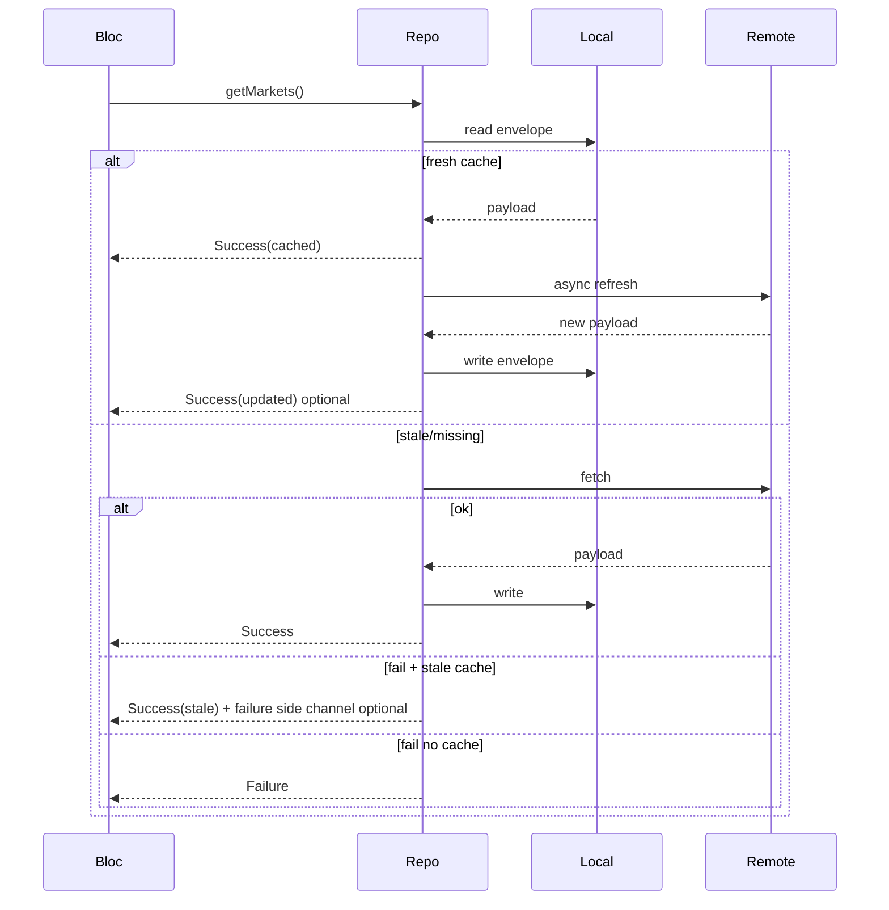

# Caching and offline behaviour

Pulse treats cache as a **first-class product feature**: fast startup, graceful offline, and explicit staleness—not an afterthought.

## Strategy overview

| Data | Pattern | TTL | Storage key | Invalidation |
|------|---------|-----|-------------|--------------|
| Markets list (top ~100) | Cache-first | **10 min** | `markets:{vsCurrency}` | Pull-to-refresh bypasses TTL |
| Coin detail metadata | Cache-first | **24 h** | `coin:{id}:{locale}` | Background refresh on open |
| Coin description / links | Cache-first | **24 h** | same blob as detail | Same |
| Chart series per range | Cache-first | see below | `chart:{id}:{range}:{vsCurrency}` | Range switch uses own key |
| Last known prices | Persist always | n/a (timestamped) | `prices:snapshot` | Updated on REST refresh + WS flush |
| Watchlist order + IDs | Local source of truth | none | `watchlist:entries` | User edits |
| Settings | Local source of truth | none | `settings:prefs` | User edits |

**Corrupt entries:** JSON decode failure or schema version mismatch → delete key, log in debug, fetch remote.

**Version field:** each cache envelope includes `schemaVersion` (int), `fetchedAt` (UTC), and `ttlSeconds` (int).

```dart
// Envelope (stored as JSON in Hive — step 3)
class CacheEnvelope {
  final int schemaVersion;
  final DateTime fetchedAt;
  final Duration ttl;
  final Map<String, dynamic> payload;
}
```

`CacheStore.readFresh` returns payload when `now < fetchedAt + ttl`; `readStale` returns payload when the entry exists but TTL has elapsed (entry kept until overwritten or corrupt).

## Chart TTLs

| UI range | Source | TTL |
|----------|--------|-----|
| 1D | Binance klines (`1m`/`5m`) or CoinGecko `market_chart?days=1` | **5 min** |
| 1W | Binance `1h` klines or CG `days=7` | **15 min** |
| 1M | Binance `4h`/`1d` or CG `days=30` | **1 h** |
| 3M | Binance `1d` or CG `days=90` | **6 h** |
| 1Y | Binance `1d`/`1w` or CG `days=365` | **24 h** |

**Implementation note:** Prefer **Binance klines** for chart shape alignment with live USDT price; use CoinGecko `market_chart` as fallback when no Binance pair exists. Document per-coin `SymbolMapper` failures in UI.

## Cache-first flow



Repositories return `Success` with `isStale` flag in model when serving expired cache due to network failure (optional field on `MarketsState`).

## Offline UX

1. Show last cached markets list and watchlist.
2. **`StaleBadge`:** label from l10n, e.g. “Updated 12 min ago” from `fetchedAt`.
3. Live prices freeze at last snapshot; realtime status `disconnected`.
4. Pull-to-refresh shows error snackbar if still offline.

## Storage package recommendation: **Hive**

| Option | Verdict |
|--------|---------|
| **Hive** | **Chosen.** Fast, embedded, strong fit for JSON blobs + typed adapters; no SQL ceremony for TTL envelopes. |
| Isar | Excellent but heavier code-gen and model coupling; overkill for ~100 coin cache. |
| sqflite / Drift | Great for relational queries; watchlist order does not need SQL. |
| shared_preferences | Fine for 5 settings keys alone; awkward for large list/chart payloads. |

**Boxes (planned):**

- `pulse_cache` — TTL envelopes (markets, detail, charts)
- `pulse_persist` — price snapshot, watchlist
- `pulse_settings` — theme, locale, currency

Register adapters in `core/storage/hive_boxes.dart` during startup before DI.

**Encryption:** not required for public market data; skip encrypted boxes unless owner requests.

## Rate-limit awareness

CoinGecko Demo: **100 calls/min** — cache-first reduces `/coins/markets` and `/coins/{id}` churn.

Binance REST: **6000 request weight/minute** per IP (from `exchangeInfo`) — batch `ticker/24hr` with `symbols` (max 100 per call).

## Testing

- Unit tests for `CacheStore`: TTL expiry, corrupt entry removal, schema bump.
- Repository tests with in-memory fake store verifying cache-first and stale fallback.

## Owner decisions

1. **Single Hive box vs three** (as above — recommend three for clear migrations).
2. **Stale Success vs Failure** when network fails but cache exists — **owner decision:** return **`Success` with `isStale: true`** for markets/watchlist; UI shows a stale label.
