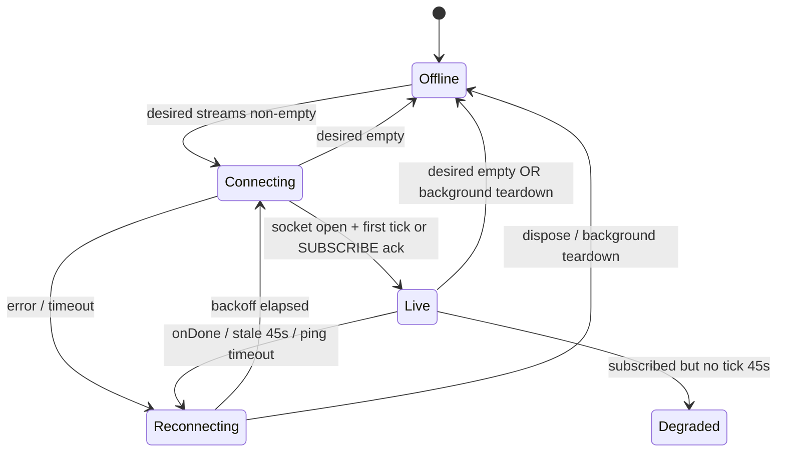

# Plan — Live prices (roadmap step 5)

## Goals

- Single shared **`PriceStreamService`** over Binance public WebSocket (`@ticker`, lowercase stream names) with ref-counted subscriptions via **`RealtimeSubscriptionCoordinator`**, ~1s throttling, reconnect with exponential backoff + jitter, ping/pong, and **`RealtimeStatus`** for UI.
- **EUR display:** Binance ticks are USDT; convert to EUR using live **`EURUSDT`** ticker (`priceEur = priceUsdt / eurUsdtRate`).
- **Markets:** merge throttled ticks into **`MarketsBloc`** (`MarketCoin.copyWith`), **`CoinListTile.showLiveFlash`**, **`LiveIndicator`** driven by status.
- **Lifecycle:** close socket ~30s after background; reconnect and restore subscriptions on resume.
- **`FakePriceStreamService`** for bloc/widget tests; fake WebSocket channel for service unit tests (no real network in CI).

## Scope alignment

| Source | Step 5 |
|--------|--------|
| [roadmap.md](../roadmap.md) | `PriceStreamService`, coordinator, markets (+ watchlist hook), throttle, backoff, status, fake for tests |
| Owner task | SUBSCRIBE/UNSUBSCRIBE (no reconnect on diff), EUR via EURUSDT, top-N subscription policy, extend `SymbolMapper` from `exchangeInfo` when practical |
| Out of scope | Coin detail bloc wiring (step 6), watchlist persistence (step 7), settings currency toggle, sub-second UI |

## File layout

```text
lib/core/realtime/
├── price_tick.dart
├── realtime_status.dart
├── price_stream_service.dart          # abstract API
├── binance_price_stream_service.dart  # WS impl (web_socket_channel)
├── realtime_subscription_coordinator.dart
├── symbol_mapper_loader.dart          # optional exchangeInfo warm (cached)
└── symbol_mapper.dart                 # extended lookup

lib/core/config/app_config.dart        # WS URL, throttle, background delay flags

lib/app.dart                           # WidgetsBindingObserver → lifecycle

lib/markets/bloc/                      # tick merge + subscription events
lib/markets/ui/markets_page.dart       # LiveIndicator, flash keys, visible subscription

test/core/realtime/
├── fake_price_stream_service.dart
├── fake_web_socket_channel.dart
├── binance_price_stream_service_test.dart
├── realtime_subscription_coordinator_test.dart
└── symbol_mapper_loader_test.dart

test/markets/bloc/markets_bloc_live_test.dart
test/markets/ui/markets_live_widgets_test.dart
```

## Connection state machine



**Status mapping (`RealtimeStatus`):**

| State | UI (`LiveIndicator`) |
|-------|----------------------|
| `offline` | Muted (inactive) |
| `connecting` | Muted |
| `live` | Active green |
| `reconnecting` | Muted (optional pulse deferred) |
| `degraded` | Muted (same as offline visually; prices may be stale) |

## WebSocket design

- **Endpoint:** `wss://stream.binance.com:9443/ws` ([Binance WebSocket streams](https://github.com/binance/binance-spot-api-docs/blob/master/web-socket-streams.md)).
- **Library:** `web_socket_channel` — standard in README; `IOWebSocketChannel` handles protocol-level ping/pong from Binance server.
- **Streams:** `<symbol>@ticker` lowercase (e.g. `btcusdt@ticker`). Always include **`eurusdt@ticker`** for conversion (not ref-counted; internal to service).
- **Control:** After connect, send batched `SUBSCRIBE` / `UNSUBSCRIBE` JSON with `params` arrays; debounce **200 ms** before sending; respect **5 msg/s** limit.
- **Parsing:** Handle wrapped `{ "stream", "data" }` and direct `{ "e":"24hrTicker", ... }` payloads; map `s`, `c`, `P`, `E`.

## Subscription / ref-count design

**`RealtimeSubscriptionCoordinator`** (singleton via DI):

- Features register **lowercase** Binance symbols with a **token** (`markets`, `watchlist`, `coinDetail`).
- `register(token, Set<String> symbols)` / `unregister(token)` updates ref counts per symbol.
- Union set (+ `eurusdt@ticker` inside service) passed to `PriceStreamService.setDesiredSymbols`.
- **`SymbolMapper.updates`** stream lets `MarketsBloc` re-bind `binanceSymbol` and live subscriptions when `SymbolMapperLoader.warmUp()` completes (non-blocking in `main`).
- **`WatchlistCubit`:** stub calls `register('watchlist', {})` until step 7 (interface ready).

## Markets visible subscription policy

Documented **top-50 policy** (no scroll instrumentation in step 5):

- From `visibleCoins`, take coins with non-null `binanceSymbol` in list order, **cap 50** symbols.
- Re-register when `visibleCoins` or loaded snapshot changes.
- Coins without a pair keep **`NoLiveFeedBadge`**; no WS subscription.

## Throttling (~1 s)

1. Service stores latest raw tick per symbol in a map.
2. **`Clock`**-driven periodic flush every **1 s** emits only symbols whose `lastPrice` or `changePercent24h` changed since last flush.
3. EUR conversion applied at flush time using latest `EURUSDT` last price.

## EUR conversion

- `eurUsdtRate` = last price from `EURUSDT` ticker (USDT per 1 EUR).
- `priceEur = priceUsdt / eurUsdtRate`.
- **`PriceTick`** carries both `lastPriceUsdt` and `lastPriceEur`. Step 7 USD display can convert from USDT (or reuse EUR with settings FX) without changing the WebSocket parser.
- Static fields (market cap, REST `currentPriceEur`) remain CoinGecko EUR; live row price/24h % can come from Binance ticker when subscribed.

## App lifecycle

| `AppLifecycleState` | Behaviour |
|---------------------|-----------|
| `resumed` | Restore coordinator union → reconnect if needed |
| `paused` / `inactive` / `hidden` | Start **30 s** timer; on fire → close socket, clear active streams, status `offline` |
| `detached` | Same as background timer |

`AppConfig.disableRealtimeLifecycleTeardown` (tests only) skips background close.

## Error handling

- Parse errors: log, ignore message.
- Socket errors: `Reconnecting`, exponential backoff `min(60s, 2^attempt) + jitter`, reset attempt after **30 s** stable `Live`.
- Stale: no WS message (incl. ping) for **45 s** while subscribed → force reconnect, emit `degraded` until tick returns.
- Blocs keep last merged prices on disconnect; REST stale badge unchanged.

## SymbolMapper / exchangeInfo

- Keep static `_knownIds` for bootstrap.
- **`SymbolMapperLoader`:** `GET /api/v3/exchangeInfo?permissions=SPOT` (weight **20**, [REST API](https://github.com/binance/binance-spot-api-docs/blob/master/rest-api.md)), cache envelope **7 days** in Hive.
- Build `baseAsset → *USDT` for `status == TRADING` and `quoteAsset == USDT`.
- Resolve: `_knownIds` first, then `baseAsset` from CoinGecko **`symbol`** (uppercase) when provided to `binanceUsdtSymbolFor`.
- Collisions / unmapped ids → `null` (no live feed).

## Test plan

| Area | Tests |
|------|--------|
| Coordinator | Ref-count union; unregister drops symbol when last token gone |
| Service | Fake channel: SUBSCRIBE/UNSUBSCRIBE diffs, ticker parse, throttle with `FakeClock`, backoff with `fake_async`, status transitions, background timer closes socket |
| EUR | USDT tick + EURUSDT rate → EUR `PriceTick` |
| `MarketsBloc` | Tick merges price/`lastLiveTickAt`; visible subscription event |
| Widget | LiveIndicator active when status live; flash border on tick |

## Out of scope (step 5)

- Viewport scroll tracking (top-50 documented instead).
- Coin detail live registration (step 6).
- Watchlist symbol registration with real data (step 7).
- `data-stream.binance.vision` alternate endpoint.
