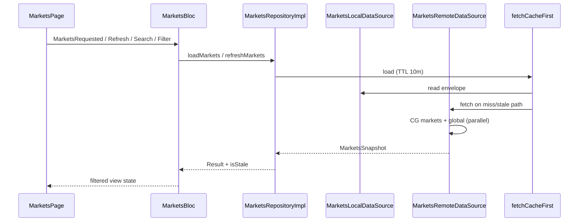

# Plan — Markets list (roadmap step 4)

## Goals

- Replace the markets placeholder with a **cache-first** top-~100 list in **EUR**, global summary card, search, gainers/losers filters, pull-to-refresh, and offline/stale UX per [caching.md](../caching.md) and [design.md](../design.md).
- Wire **CoinGecko Demo** (`/coins/markets`, `/global`) through existing `ApiClient` + `fetchCacheFirst`.
- Prepare for step 5 live prices: **LIVE** indicator is visual-only; **no live feed** badge when `SymbolMapper.binanceUsdtSymbolFor` returns null.

## Scope alignment

| Source | Markets step |
|--------|----------------|
| [roadmap.md](../roadmap.md) step 4 | Models, remote (CG markets + global; Binance 24hr batch **deferred** to step 5 when prices merge), local cache, repository, bloc, UI |
| Owner task | EUR list + sparkline, global summary, filters (hide Watchlist chip), search, shimmer/error/empty, navigate `/coin/:id` |
| Out of scope | WebSocket / `PriceStreamService`, watchlist filter data, settings currency toggle, infinite scroll (single page `per_page=100`), Binance REST batch (documented; mapper-only badge) |

## File layout

```text
lib/markets/
├── models/
│   ├── market_coin.dart
│   ├── global_market_summary.dart
│   └── markets_snapshot.dart
├── repository/
│   ├── markets_repository.dart
│   ├── markets_repository_impl.dart
│   └── data_sources/
│       ├── markets_remote_data_source.dart
│       └── markets_local_data_source.dart
├── bloc/
│   ├── markets_bloc.dart
│   ├── markets_event.dart
│   └── markets_state.dart
└── ui/
    ├── markets_page.dart
    └── widgets/
        └── markets_list_view.dart

test/markets/
├── fixtures/
│   ├── coingecko_markets_page1.json
│   └── coingecko_global.json
├── models/market_coin_test.dart
├── repository/markets_repository_impl_test.dart
├── bloc/markets_bloc_test.dart
└── ui/markets_page_test.dart
```

## Data flow



## Models

- **`MarketCoin`**: `id`, `symbol`, `name`, `imageUrl`, `currentPriceEur`, `priceChangePercent24h`, `marketCapRank`, `sparkline7d`, optional `binanceSymbol` (from `SymbolMapper`).
- **`GlobalMarketSummary`**: `totalMarketCapEur`, `marketCapChangePercent24h` (from `market_cap_change_percentage_24h_usd` when EUR-specific change is absent on `/global`).
- **`MarketsSnapshot`**: `coins`, `global`, `fetchedAt` (UTC); JSON round-trip for Hive envelope payload.

## Remote API

| Call | Path | Notes |
|------|------|--------|
| CoinGecko | `GET /coins/markets` | `vs_currency=eur`, `order=market_cap_desc`, `per_page=100`, `page=1`, `sparkline=true`, `price_change_percentage=24h` |
| CoinGecko | `GET /global` | `total_market_cap.eur`, change % from `market_cap_change_percentage_24h_usd` |

**Rate limits verified (2026-11-01):**

- CoinGecko Demo: **100 requests/minute** — [Errors & rate limits](https://docs.coingecko.com/docs/errors-and-rate-limits); markets screen uses **2 calls** per refresh (markets + global), cache-first TTL **10 min** keeps steady-state ≪ limit.
- CoinGecko `/coins/markets`: `per_page` **1–250** — [Coins markets reference](https://docs.coingecko.com/reference/coins-markets).
- Binance `GET /api/v3/ticker/24hr?symbols=[...]`: max **100** symbols, weight **40** for 21–100 symbols — [api.md](../api.md) citing [Binance REST](https://github.com/binance/binance-spot-api-docs/blob/master/rest-api.md); **not called in step 4** (step 5 fusion).

## Cache keys and TTL

| Key | TTL | Schema |
|-----|-----|--------|
| `markets:eur` | **10 min** | `schemaVersion: 1` — payload `{ coins, global, fetchedAt }` |

Pull-to-refresh uses **`refreshMarkets()`** (bypass TTL). Offline refresh → `Success(isStale: true)` if envelope exists; else `Failure(NetworkFailure(offline: true))` and snackbar.

## Repository

```dart
abstract class MarketsRepository {
  Future<Result<MarketsSnapshot>> loadMarkets();
  Future<Result<MarketsSnapshot>> refreshMarkets();
}
```

- **`loadMarkets`**: `fetchCacheFirst` with `MarketsLocalDataSource` encode/decode.
- **`refreshMarkets`**: skip fresh read; online fetch + write; stale fallback on failure.

## Bloc

**Events:** `MarketsRequested`, `MarketsRefreshRequested`, `MarketsSearchQueryChanged`, `MarketsFilterChanged`.

**State (`MarketsState`):** `status` (initial/loading/loaded/failure), `snapshot`, `isStale`, `searchQuery`, `filter` (all/gainers/losers), `visibleCoins` (derived), `failure`, `fetchedAt`.

**Concurrency:** `restartable()` on search; `droppable()` on refresh (via `bloc_concurrency`).

**Client behaviour:**

- Search: case-insensitive match on `name`, `symbol`, `id`.
- Filters: gainers `priceChangePercent24h > 0`, losers `< 0`; empty filter → empty state with l10n.
- Sort: API order (**market cap desc**); no sort UI in step 4.

## UI (`MarketsPage`)

- Title + **LiveIndicator** (static placeholder) + search affordance.
- **OfflineBanner** when `isStale`, minutes from `fetchedAt`.
- **FilterChipsRow** with watchlist chip **hidden** (`includeWatchlistChip: false`).
- **MarketSummaryCard** from global summary.
- **RefreshIndicator** + list of **CoinListTile** (network image icon, sparkline, EUR formatters, no-live-feed badge).
- Loading: **ShimmerSkeleton** list; error: message + retry; empty: filter/search copy.
- Tap → `context.push(AppRoutes.coinDetailPath(id))`.

## Error handling

| Case | Behaviour |
|------|-----------|
| No cache, offline | Full-screen error + retry |
| Cache, offline load | List + stale banner |
| Refresh offline | Stale banner + snackbar (`errorOffline`) |
| 429 / 5xx | `AppFailure.message(l10n)` on full failure; stale cache still wins with banner |

## DI

Register in `lib/core/di/injection.dart`:

- `MarketsRemoteDataSource`, `MarketsLocalDataSource`, `MarketsRepository` → `MarketsRepositoryImpl`.

## Tests

| Area | Cases |
|------|--------|
| Models | Parse fixture JSON; null-safe sparkline |
| Repository | Fresh cache hit (no remote); stale offline; remote success writes cache; remote fail + stale; remote fail no cache |
| Bloc | Initial load success/failure; refresh; search filters; gainers/losers empty |
| Widget | Shimmer while loading; error retry button; stale banner visibility |

## Documentation updates (this PR)

- This plan; minor [api.md](../api.md) global endpoint row; [roadmap.md](../roadmap.md) step 4 test list + global summary note.

## Out of scope

- Binance 24hr REST batch and live price merge (step 5).
- Watchlist chip functionality (step 7).
- Display currency / locale from settings (step 7) — hardcode `eur` + device locale for formatters only.
