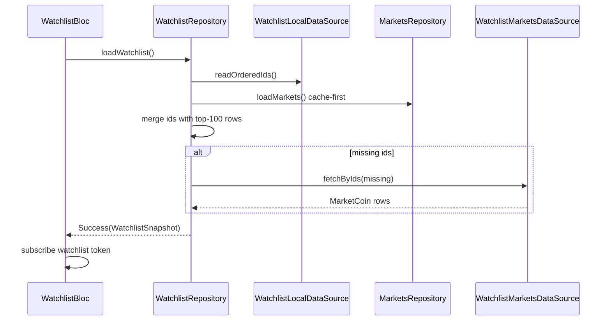

# Plan — Watchlist & Settings (roadmap step 7)

## Goals

- Replace the in-memory [WatchlistToggle] stub with **Hive-persisted** ordered coin ids (add / remove / reorder; survives restart).
- Ship the **Watchlist** screen per [design.md](../design.md): edit/reorder, swipe remove + undo snackbar, live prices via coordinator token `watchlist`, offline banner, empty state CTA to Markets.
- Ship **Settings**: theme (system / light / dark), language (EN / `sr_Latn`), display currency (EUR / USD), clear cache, about + version + GitHub link, debug Design gallery entry.
- Wire preferences into **MaterialApp** (theme / locale) and **CoinGecko `vs_currency`** + live tick display (EUR conversion vs `lastPriceUsdt` for USD).
- Enable **Markets** watchlist filter chip and star toggle on rows; keep coin detail star wired to the same repository.

## Scope alignment

| Source | Step 7 |
|--------|--------|
| [roadmap.md](../roadmap.md) | Persistence, reorder, swipe + undo, settings theme/locale/currency, l10n |
| Owner task | Hive watchlist, coordinator `watchlist` token, cache-first fetch for ids not in top-100, full test matrix |
| [design.md](../design.md) | Watchlist title + Edit, larger sparkline variant, empty hint + CTA |
| Out of scope | React Native twin, push notifications, portfolio holdings, encrypted Hive, README screenshot section |

**Note vs design.md rule 1:** Phase-1 copy said “EUR only until settings”; step 7 implements the settings currency toggle (EUR default, USD optional).

## File layout

```text
lib/core/storage/
├── hive_boxes.dart              # + pulse_persist, pulse_settings
├── preferences_store.dart       # settings JSON in pulse_settings
lib/settings/
├── models/
│   ├── user_preferences.dart
│   └── display_currency.dart
├── repository/
│   └── settings_repository.dart
├── bloc/
│   ├── settings_cubit.dart
│   └── settings_state.dart
└── ui/
    └── settings_page.dart
lib/watchlist/
├── models/
│   └── watchlist_snapshot.dart
├── repository/
│   ├── watchlist_repository.dart
│   ├── watchlist_repository_impl.dart
│   └── data_sources/
│       ├── watchlist_local_data_source.dart
│       └── watchlist_markets_data_source.dart   # ids= fetch + cache
├── bloc/
│   ├── watchlist_bloc.dart
│   ├── watchlist_event.dart
│   └── watchlist_state.dart
└── ui/
    └── watchlist_page.dart
lib/coin_detail/watchlist/
└── watchlist_toggle.dart        # Hive-backed impl delegating to repository
```

Markets changes: `markets_repository` (+ `loadMarketsForIds`), `markets_bloc` (watchlist filter + `WatchlistRepository`), `markets_page` (chip + star), `injection.dart`, `app.dart`.

## Storage schema

### Boxes ([caching.md](../caching.md))

| Box | Keys |
|-----|------|
| `pulse_persist` | `watchlist:entries` |
| `pulse_settings` | `settings:prefs` |
| `pulse_cache` | unchanged + `markets:by_ids:{vsCurrency}:{idsHash}` TTL 10 min |

### Watchlist (`watchlist:entries`)

```json
{
  "schemaVersion": 1,
  "coinIds": ["bitcoin", "ethereum", "chainlink"]
}
```

- Order in `coinIds` is display order (index 0 = top).
- **Migration:** unknown `schemaVersion` → delete key, start empty list.

### Settings (`settings:prefs`)

```json
{
  "schemaVersion": 1,
  "themeMode": "system|light|dark",
  "localeCode": "en|sr_Latn",
  "displayCurrency": "eur|usd"
}
```

Defaults: `themeMode=system`, `localeCode=en`, `displayCurrency=eur`.

## Data flow — watchlist coins



Live ticks merge like [MarketsBloc](../../lib/markets/bloc/markets_bloc.dart) using `PriceTick.lastPriceEur` or `lastPriceUsdt` when USD is selected.

## Bloc / cubit design

### WatchlistBloc

| Event | Behaviour |
|-------|-----------|
| `WatchlistRequested` | Load snapshot; sync live symbols |
| `WatchlistRefreshRequested` | Bypass TTL on ids fetch path |
| `WatchlistRemoveRequested` | Remove id; emit pending undo payload |
| `WatchlistUndoRemoveRequested` | Re-insert at prior index |
| `WatchlistReorderRequested` | Persist new order |
| `WatchlistPriceTickReceived` | Merge tick into coin row |
| `WatchlistRealtimeStatusChanged` | Update status |
| `WatchlistDisplayCurrencyChanged` | Reload when settings change (via stream) |

State: `status`, `coins`, `isStale`, `fetchedAt`, `realtimeStatus`, `isEditing`, `pendingUndo`, live flash fields.

On `close`: `subscriptionCoordinator.removeToken('watchlist')`.

### SettingsCubit

- Loads prefs on start; `updateTheme`, `updateLocale`, `updateDisplayCurrency`, `clearCache`.
- Exposes `Stream<UserPreferences>` or state for `PulseApp` to rebuild.
- `clearCache` calls `CacheStore.clear()` only (not watchlist/settings boxes).

### MarketsBloc additions

- Depends on `WatchlistRepository` for filter chip + membership checks.
- `MarketFilter.watchlist` filters to watched ids (merged list from repository helper).
- Listens to settings currency changes → `MarketsRequested`.

## Live integration

| Screen | Token | Symbol set |
|--------|-------|------------|
| Markets | `markets` | visible rows (cap 50) |
| Watchlist | `watchlist` | all watched rows with Binance pair |
| Coin detail | per-coin token (existing) | single symbol |

## Settings persistence

- [PreferencesStore](../../lib/core/storage/preferences_store.dart) reads/writes JSON in `pulse_settings`.
- [SettingsRepository](../../lib/settings/repository/settings_repository.dart) maps to [UserPreferences](../../lib/settings/models/user_preferences.dart).
- Applied live: `PulseApp` uses `BlocBuilder<SettingsCubit, SettingsState>` for `themeMode`, `locale`, and notifies repos via registered callback or direct read on each request.

## Markets / CoinGecko currency

- `MarketsRemoteDataSource.vsCurrency` and `MarketsRepositoryImpl.vsCurrency` read from `SettingsRepository.current.displayCurrency.coingeckoCode`.
- Cache keys remain `markets:{vsCurrency}` per [markets plan](markets.md).
- Global summary uses same `vsCurrency` key in `/global` payload parser.

## UI notes

- **Watchlist empty:** `watchlistEmptyHint` + button → `go_router` Markets tab.
- **Swipe remove:** `Dismissible` + snackbar with undo action (l10n).
- **Edit mode:** toggles `ReorderableListView` vs normal list; app bar action uses `watchlistEdit`.
- **Settings about:** app version from `package_info_plus`; link opens GitHub repo URL constant in `AppConfig`.

## Test plan

| Area | Tests |
|------|-------|
| Watchlist local | add/remove/reorder/persist across store reopen |
| Watchlist repository | merge top-100 + ids fetch mock |
| Watchlist bloc | load, tick merge, remove+undo, stale, token removed on close |
| Settings | cubit persistence with fake PreferencesStore |
| Widgets | watchlist empty, swipe+undo, reorder; settings theme/locale switches |
| L10n | one widget per locale (EN + sr_Latn) |
| Markets | watchlist filter with mock ids |

All network via mocks; `FakePriceStreamService` for live tests.

## Dependencies

- `package_info_plus` — About screen version (optional in architecture; added in step 7).

## Deferred

- Background WebSocket policy beyond existing lifecycle hook.
- Pull-to-refresh on watchlist (optional; include if trivial with repository refresh).
- Separate `MarketCoin.currentPriceUsd` field (reuse `currentPriceEur` as vs-currency price from API to limit model churn; documented here).

## Review follow-up (PR #12)

- **Cross-tab sync:** `WatchlistRepository.membershipChanges` stream; `WatchlistBloc` and `MarketsBloc` subscribe and cancel in `close()`.
- **Coin detail currency:** `SettingsRepository` drives CoinGecko `vs_currency`, cache keys, preference reload, and USD/EUR live tick merge.
- **Data integrity:** dedupe ids on read; unavailable placeholder rows when supplemental fetch misses an id.
- **Settings UX:** `cacheClearGeneration` re-triggers clear-cache snackbar; swipe dismiss uses `colorScheme.onError`.
- **Cache keys:** stable sorted-id hash for `markets:by_ids`; documented in [caching.md](../caching.md).
- **Tests:** repository merge/stale, bloc membership/ticks/undo/preferences, widget swipe/reorder/settings, markets watchlist filter, coin detail currency, membership stream mocks.
