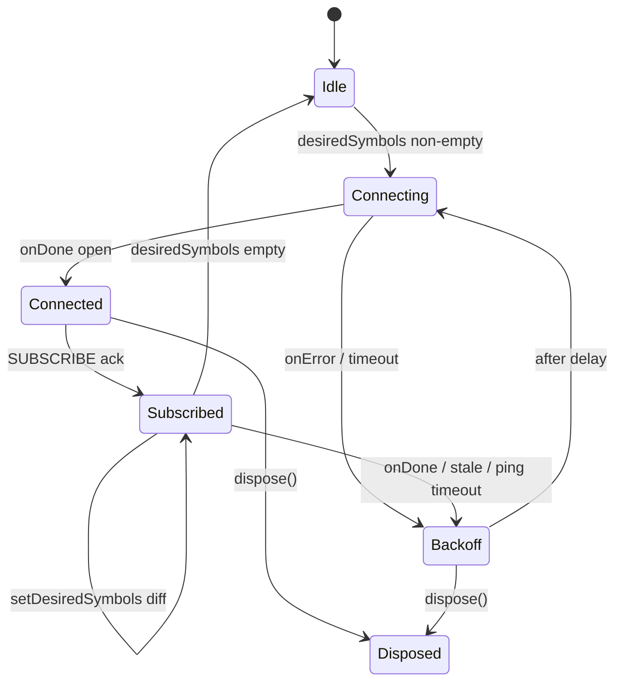

# Real-time: `PriceStreamService`

Pulse’s differentiator is a **single shared Binance WebSocket** that feeds every visible screen, with controlled subscription churn, reconnect logic, and **~1s throttling** before ticks reach Blocs.

## Goals

- One connection to `wss://stream.binance.com:9443` (combined stream URL: `/stream?streams=...` or dynamic `SUBSCRIBE` on `/ws`).
- Subscribe only to **Binance symbols** currently needed (markets viewport + watchlist + open coin detail).
- Survive 24h server disconnects, ping/pong requirements, and brief offline periods.
- Keep Blocs testable via a **`PriceStreamService` interface** and `FakePriceStreamService` in tests.

## Non-goals

- Sub-second trading UI (throttled intentionally).
- Private/user streams (no API key).
- CoinGecko WebSocket (metadata stays REST; prices from Binance).

## Public API (planned)

```dart
abstract class PriceStreamService {
  /// Emits throttled price updates for subscribed symbols.
  Stream<PriceTick> get ticks;

  /// Current connection health for UI badges / debug overlay.
  Stream<RealtimeStatus> get status;

  /// Replace the desired subscription set (lowercase Binance symbols, e.g. btcusdt).
  void setDesiredSymbols(Set<String> symbols);

  /// Pause processing (app background); keep socket policy configurable.
  void setAppLifecycle(AppLifecycleState state);

  Future<void> dispose();
}
```

```dart
class PriceTick {
  final String symbol;       // Binance symbol, uppercase in domain layer
  final double lastPrice;
  final double? changePercent24h; // from 24hr ticker stream when available
  final DateTime eventTime;
}
```

## Stream choice

Use **`@ticker`** (individual symbol ticker streams), not `@trade`:

| Stream | Update rate | Payload |
|--------|-------------|---------|
| `<symbol>@ticker` | ~1000 ms | Last price, 24h change % (`P`), event time (`E`) |

Alternative `@miniTicker` is lighter but omits some fields; `@ticker` matches markets list needs.

Official reference: [Binance WebSocket streams](https://github.com/binance/binance-spot-api-docs/blob/master/web-socket-streams.md).

## Connection lifecycle



### Open

1. If `desiredSymbols` is empty → stay **Idle** (no socket).
2. Open **combined** connection:  
   `wss://stream.binance.com:9443/stream`  
   with JSON control messages (`SUBSCRIBE` / `UNSUBSCRIBE`) after connect, **or** build initial URL with up to N streams (prefer dynamic SUBSCRIBE when the set changes often).
3. Binance limits: **5 incoming messages per second** per connection; batch subscribe/unsubscribe in one message when possible (`params`: array of stream names).

### Subscribe set diff

- Maintain `_activeStreams` and `_desiredStreams`.
- On `setDesiredSymbols`, compute add/remove; send `UNSUBSCRIBE` then `SUBSCRIBE` only for the delta.
- Debounce rapid UI changes (e.g. 200 ms) before sending control messages to avoid flooding.

### Heartbeat and stale detection

- Binance sends **ping every 20s**; client must **pong** with matching payload promptly (documented max ~60s before disconnect).
- Implement with `web_socket_channel` + custom ping handler (or IOWebSocketChannel pingInterval for client-side keepalive).
- **Stale:** if no message (including ping) for **45s** while subscribed, force reconnect.
- Emit `RealtimeStatus.degraded` when stale; `RealtimeStatus.live` on first tick after reconnect.

### 24-hour disconnect

- Expect disconnect at **24h**; treat as normal `onDone` → exponential backoff → reconnect.

### Exponential backoff

| Attempt | Delay (cap 60s) |
|---------|------------------|
| 1 | 1s |
| 2 | 2s |
| 3 | 4s |
| … | min(60s, 2^n) + jitter |

Reset attempt counter after **30s** of stable connected state.

## Throttling (~1 s)

Raw `@ticker` fires about once per second per symbol; with ~100 symbols, Blocs would still rebuild heavily.

**Policy:**

1. Service maintains `Map<symbol, PriceTick> _latestRaw`.
2. A periodic timer (**1 s**) or `Stream.periodic` flushes **changed** symbols to `ticks` broadcast stream.
3. Coalesce: only emit if `lastPrice` or `changePercent24h` changed since last flush.

Blocs listen to `ticks` and patch list/detail state immutably.

## App background / foreground

| State | Behaviour (default) |
|-------|---------------------|
| `paused` / `inactive` | Call `setDesiredSymbols({})` **or** keep socket but stop flush timer (config flag). **Recommended:** disconnect after **30s** in background to save battery; rely on cache + REST refresh on resume. |
| `resumed` | Restore subscriptions from a `SubscriptionRegistry` owned by shell or a small coordinator. |

Document the chosen flag in `AppConfig` so tests can disable lifecycle teardown.

## Error states and `RealtimeStatus`

```dart
sealed class RealtimeStatus {
  const RealtimeStatus();
}
// offline | connecting | live | reconnecting | degraded
```

- **UI:** optional subtle indicator on markets/watchlist when not `live`; do not block interaction.
- **Bloc merge:** if `disconnected`, keep last prices; show `StaleBadge` from cache timestamp (see caching.md).

## Integration with Blocs

**Symbol mapping:** Static `_knownIds` plus **`SymbolMapperLoader`** (cached `GET /api/v3/exchangeInfo`, weight 20) maps CoinGecko **symbol** → `*USDT` when trading. Unknown ids return `null` → **“no live feed”** badge.

**MarketsBloc**

- Registers symbols via **`RealtimeSubscriptionCoordinator`** using the **top-50** policy on filtered `visibleCoins` (see [plans/live-prices.md](plans/live-prices.md)).
- On `MarketsBloc` close → remove its symbols from registry (coordinator reference-counts).

**WatchlistCubit**

- Registers all watchlist symbols.

**CoinDetailBloc**

- Registers single symbol while page is active.
- Subscribes to the shared **`ticks`** broadcast and **ignores** events for other symbols (only merges when `tick.symbol` matches the open coin’s Binance pair).

**Coordinator (recommended):** `RealtimeSubscriptionCoordinator` in `core/realtime/` merges requests from features so `PriceStreamService` sees one union set.

## Testing strategy

| Layer | Approach |
|-------|----------|
| Unit | `FakePriceStreamService` implements interface; manual `emitTick()` |
| Service | Inject mock `WebSocketChannel` / use `package:web_socket_channel` test harness |
| Bloc | `bloc_test` verifies merge logic given tick sequence |
| Integration | Optional: tagged test hitting Binance testnet/public (not in CI default) |

**Fake example behaviour:**

- `setDesiredSymbols` records calls.
- `simulateDisconnect()` → status `disconnected` → `simulateReconnect()` → replay subscribed set.

## Binance constraints checklist

Verified from official docs (Oct 2025; re-check before implementation):

- [x] Base: `wss://stream.binance.com:9443` or `:443`
- [x] Max **1024** streams per connection
- [x] Max **5** incoming JSON/control messages per second
- [x] Connection valid **24 hours**
- [x] Server **ping** every **20s**; client **pong** required
- [x] **300** connection attempts per **5 minutes** per IP — avoid reconnect storms

### Open (implemented in step 5)

Pulse uses **`wss://stream.binance.com:9443/ws`** with dynamic **`SUBSCRIBE` / `UNSUBSCRIBE`** JSON (not the combined `/stream?streams=` URL at connect). Control messages are rate-limited to **5/s**; subscription acks reconcile the active set.

**Stale detection:** the client timer resets on **`@ticker` JSON** received on `WebSocketChannel.stream`. Binance server **ping frames** on `IOWebSocketChannel` are handled at the protocol layer and may **not** appear on `stream`; with subscriptions active, `@ticker` traffic (~1s) keeps the connection fresh. Tune `AppConfig.realtimeStaleAfter` (default **45s**) accordingly.

## Open choices for owner

1. **Disconnect in background** vs keep-alive (battery vs freshness).
2. **Combined stream URL** at connect vs always use `SUBSCRIBE` on `/ws` (prefer SUBSCRIBE when symbol set changes frequently).
